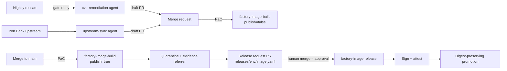

# Image Hardening Factory

Image Hardening Factory rebuilds the Iron Bank **Bitbucket, Jira, and Confluence
Data Center LTS** images (`bitbucket-lts`, `jira-lts`, `confluence-lts`) on an
internal hardened UBI 9 base and produces, for every candidate:

- a digest-pinned OCI image built rootless from signed, locked inputs
- CycloneDX and SPDX SBOMs
- vulnerability scan evidence (Grype, Trivy, OSV-Scanner) with CISA KEV flags
- an OPA release decision bound to the candidate digest
- Cosign signatures and in-toto attestations, plus Tekton Chains SLSA provenance

Pipelines run on **Tekton**, triggered by **Pipelines-as-Code** (PaC) from an
internal **GitLab** instance, with **Artifactory** holding every artifact. Day-to-day
upkeep — failure triage, CVE remediation, Iron Bank upstream tracking, release
briefings, exception hygiene, and pipeline reviews — is assisted by **Claude Code
agents** that can only *propose* changes for human review.

It is a build-and-evidence system, not a deployment platform. Every stage is a
plain Kubernetes pod running daemonless tools on **Kubernetes 1.28+**; nothing
runs a container engine or the candidate image. Compliance scanning (OpenSCAP),
malware scanning, and runtime product tests are out of scope and belong to the
consuming environment — see [docs/scope.md](docs/scope.md).



## New here? Start in 10 minutes

Day-one needs Python 3.11+, git, and the GNU `sha256sum` and `sort` the seal
scripts use (`brew install coreutils` on macOS). That is all: there is no
host-side build toolchain, container runtime, or local cluster harness. Images
are built only by the Tekton Task, in a cluster.

```bash
python3 -m venv .venv && . .venv/bin/activate
pip install -e '.[dev]'
make ci          # validate, tekton-check, release-requests, lint, test (+ opa if present)
make agents      # list the agent personas
```

To build an image for real, open a merge request (the PR pipeline builds,
scans, and gates without publishing) or run the pipeline on a development
cluster with a local-cluster environment such as `deploy/environments/dev` ([docs/operations.md](docs/operations.md#running-the-full-pipeline-on-a-local-cluster)).

### Work with the agents interactively

Open the repository in Claude Code. `CLAUDE.md`, the personas in
`.claude/agents/`, the skills in `.claude/skills/`, and the guard hooks in
`.claude/settings.json` load automatically. For example: *"use the
upstream-sync agent to explain what changed upstream for jira-lts"*.

## How a change flows

1. **Merge request** (GitLab; PaC calls the event `pull_request`) — PaC runs
   `factory-checks` and, for each image whose inputs changed,
   `<image>-on-pull-request`: validate → prepare → rootless build → SBOM →
   scan/assessment → gate. Nothing is published.
   Failures get a triage comment from the `failure-triage` agent.
2. **Merge to `main`** — `<image>-on-push` repeats the build, imports the passing
   candidate into quarantine, attaches its evidence bundle as an OCI referrer, and
   opens a **release request** change (`releases/<env>/<image>.yaml`) with a
   readiness briefing from the `release-readiness` agent.
3. **Release** — merging the release request (CODEOWNERS-reviewed; the merger is
   the approver of record) runs `factory-image-release`: verify evidence → sign and
   attest with the environment key → promote by digest → publish the base release
   pointer → rebuild dependents if a base changed.
4. **Every night** — each image is re-gated against fresh vulnerability data. A
   deny hands off to the `cve-remediation` agent, which opens a draft fix.

## Repository map

| Path | Purpose |
|---|---|
| `catalog/images/` | What to build and its policy (schema in `factory/schemas/`) |
| `overlays/<image>/patches/` | Factory patches applied on top of the Iron Bank source |
| `.tekton/tasks/`, `.tekton/pipelines/` | Tekton Tasks and Pipelines |
| `.tekton/*-on-*.yaml` | Generated PaC PipelineRuns (`make tekton-render`) |
| `deploy/` | Namespace, ServiceAccounts, NetworkPolicies, Repository CR, schedules, admission policy, Chains config |
| `toolchain/` | Runner image Containerfiles and the pinned-tool downloader (`make toolchain`) |
| `releases/` | Release requests; merging one signs and promotes |
| `.claude/` | Agent personas, skills, settings, and hooks for Claude Code |
| `agents/` | CI agent settings and output schemas |
| `factory/` | Python: catalog, planning, findings, gate input, Tekton rendering, agents, release requests |
| `scripts/` | Stage scripts; `scripts/tekton/` runtime helpers; `scripts/agents/` agent plumbing |
| `policies/` | OPA release policy and approved exceptions |
| `tests/` | Unit tests |

## Documentation

- [Scope](docs/scope.md) — what the pipeline does, what it leaves to others, platform floor
- [Architecture](docs/architecture.md) — triggers, pipelines, trust classes, sealing, release flow
- [AI agents](docs/agents.md) — personas, isolation model, guardrails, operations
- [Configuration](docs/configuration.md) — cluster install, settings, secrets, Repository CR
- [Operations](docs/operations.md) — bootstrap, release process, day-2 cadence, runbooks
- [Evidence model](docs/evidence-model.md) — what is produced, signed, and verified
- [Migration from Jenkins](docs/migration-from-jenkins.md) — concept mapping
- [Implementation status](docs/implementation-status.md)

## Notes and expectations

- This is an integration reference implementation that evolves actively.
- Production use needs environment-specific clusters, credentials, signing keys,
  repositories, network policy endpoints, and an approved LLM gateway.
- Never commit generated outputs (`work/`, OCI archives, proprietary binaries)
  or credentials.
