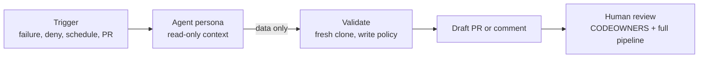
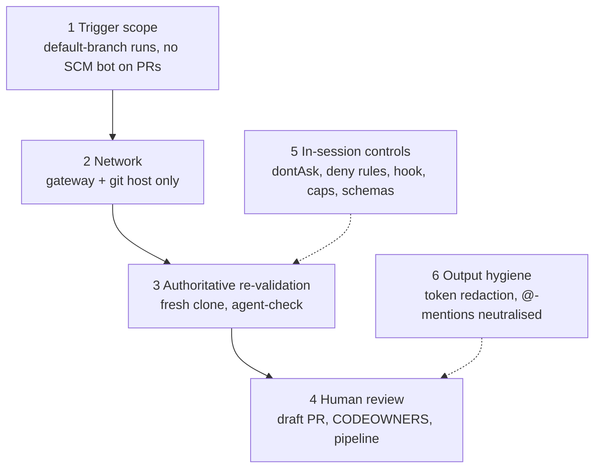

# AI agents for factory operations

[Project overview](../README.md) · [Architecture](architecture.md) · [Operations](operations.md)

**Claude Code** agents do the recurring work that keeps the three Iron Bank
Atlassian images releasable: explaining failures, fixing vulnerabilities,
following upstream, briefing approvers, pruning exceptions, and reviewing risky
pipeline changes. Agents **propose**; humans and the pipeline **decide**. No
agent can merge, sign, publish, approve, or add a vulnerability exception.



## Personas

Each persona is a Claude Code
[subagent](https://code.claude.com/docs/en/sub-agents) in
`.claude/agents/<name>.md`. The same file serves interactive sessions and CI. An
`x-factory` frontmatter block (ignored by Claude Code) declares the CI contract:
output schema, budget, modes, and the exact paths it may write.

| Persona | Runs | Reads | Produces | May write |
|---|---|---|---|---|
| `failure-triage` | `finally` of any failed build or release run | stage log tails, evidence summaries, task statuses | PR/commit comment: category, root cause, next steps | nothing |
| `cve-remediation` | gate deny on `main`, nightly rescan, base-release rebuild | blocking findings, SBOM components, catalog, exceptions | draft PR + plan | `overlays/`, `catalog/images/` (revision, version, build args only) |
| `upstream-sync` | weekday schedule | per-image upstream recon: new Repo One head, key-file diffs, manifest tags/args, overlay trial-apply results | draft PR with rebased patches and moved pins | `overlays/` (incl. deletes), `catalog/images/`, `vendir/config.yml` |
| `release-readiness` | after quarantine import on `main` | gate result and warnings, exceptions in scope, previous release request | body of the release-request PR | nothing |
| `exception-steward` | weekly schedule | approved exceptions, evidence of each image's current release | draft PR removing stale exceptions + review list | `policies/exceptions/approved.json`, **removals only** |
| `pipeline-reviewer` | PRs touching `.tekton/`, `deploy/`, `scripts/`, `policies/`, `factory/`, `.claude/`, `agents/`; or `/review` | PR diff, checklist, repository at the PR revision | PR comment with verdict and findings | nothing |

Skills in `.claude/skills/` hold domain procedures that personas preload:
`ironbank-overlays`, `atlassian-lts`, `evidence-model`, `tekton-factory`.

## How a CI agent run works

`.tekton/tasks/factory-claude-agent.yaml` runs one persona as five sequential
containers in one pod. Credentials never share a container, or a lifetime, with
the agent.

```mermaid
sequenceDiagram
    participant C as context (no secrets)
    participant A as agent (LLM gateway token)
    participant V as validate (no secrets)
    participant P as publish (SCM bot token)
    participant R as report (PaC provider token)
    C->>C: verify checkout == commit; private clone; gather inputs
    C->>A: agent/context, agent/repo
    A->>A: claude --bare -p ... (dontAsk, caps, JSON schema)
    A->>A: scrub own token from outputs
    A->>V: result.json, edits in agent/repo
    V->>V: schema check, write-policy check, change.patch, report.md
    V->>P: patch + report (data only)
    P->>P: fresh clone of pinned commit, re-validate, push branch, open draft PR
    V->>R: report.md (data only)
    R->>R: inline curl comment (no workspace code)
```

`factory.agents.build_command` builds the CLI call, and unit tests cover it:

```text
claude --bare -p "<task prompt>"
  --model <persona model> --append-system-prompt-file <CLAUDE.md + persona + skills + run contract>
  --settings agents/ci/settings.json
  --tools <persona tools> --allowedTools <Read/Grep/Glob, Edit(/<writable>/**), Bash(<allowlist>)>
  --disallowedTools WebFetch WebSearch
  --permission-mode dontAsk --permission-prompts none
  --max-turns <n> --max-budget-usd <usd>
  --output-format json --json-schema <persona schema>
  --add-dir <context> --no-session-persistence
```

**Why `--bare`:** without it, `claude -p` loads hooks, MCP servers, and settings
from the working directory with no trust prompt. Bare mode
([headless docs](https://code.claude.com/docs/en/headless#start-faster-with-bare-mode))
loads only what the command line passes, so a malicious change cannot smuggle a
hook or MCP server into a run.

## Guardrails, outermost first



| # | Layer | What it enforces |
|---|---|---|
| 1 | Trigger scope | Agent PipelineRuns come from the default branch. PR runs never bind the SCM bot (`scm-secret` defaults to a Secret that does not exist), and the admission policy enforces that at pod creation. |
| 2 | Network | Agent pods reach only the LLM gateway and the git host (`deploy/base/network-policies.yaml`): no internet, registry, or cluster API. |
| 3 | Re-validation | Publish fetches the pinned commit afresh (objects hash-verified) and runs *that* code's `factory.cli agent-check`: path allowlist, protected prefixes, no symlinks, deletions only where allowed, frozen catalog policy fields, revision/vendir consistency, exceptions remove-only. Agent output is only data. |
| 4 | Human review | Every proposal is a draft change request; branch protection, CODEOWNERS, and the full factory pipeline decide. |
| 5 | In-session controls (defence in depth) | `dontAsk` mode with narrow allow rules, deny rules in `agents/ci/settings.json`, the `.claude/hooks/guard-paths.sh` PreToolUse hook, turn/budget/time caps, strict JSON Schemas. |
| 6 | Output hygiene | The agent step redacts its gateway token from every output and discards proposals containing it. Reports neutralise `@`-mentions. |

**Residual risk:** the agent process can read the gateway token. Scope it to
model access, rate-limit it, and rotate it. Agent text in comments is untrusted
and labelled advisory.

## Model access and limits

Set `ANTHROPIC_BASE_URL` (ConfigMap `factory-settings`) to your Anthropic-format
LLM gateway and store its token in Secret `factory-ai-gateway`.

| Setting | Effect |
|---|---|
| `sonnet`, `opus` aliases | what personas use |
| `ANTHROPIC_DEFAULT_SONNET_MODEL`, `ANTHROPIC_DEFAULT_OPUS_MODEL` | map the aliases to the gateway's model names |
| `FACTORY_AGENT_MODEL_<PERSONA>` | per-persona override, for example `FACTORY_AGENT_MODEL_UPSTREAM_SYNC` |
| `FACTORY_AGENT_TIMEOUT` | wall-clock limit per run (default 1500 s) |

The agent image pins the Claude Code CLI (`tools/versions.lock.yaml`,
`toolchain/Containerfile.factory-agent`).

| Persona | Model | Max turns | Budget (USD) |
|---|---|---|---|
| failure-triage | sonnet | 25 | 2 |
| release-readiness | sonnet | 20 | 2 |
| exception-steward | sonnet | 25 | 3 |
| pipeline-reviewer | opus | 30 | 5 |
| cve-remediation | opus | 40 | 8 |
| upstream-sync | opus | 60 | 12 |

The `claude` JSON result records `total_cost_usd` and `num_turns`; the agent step
prints both to the TaskRun log.

## Using the agents interactively

In a Claude Code session at the repository root, the personas are subagents, and
the guard hook asks before edits to trust-boundary files and blocks edits to
generated PipelineRuns. Examples:

- "Have failure-triage look at `work/jira-lts` from my local build."
- "Use upstream-sync to rebase the confluence-lts overlays onto the new Repo One head."
- "Ask pipeline-reviewer to review my change to `.tekton/tasks/factory-quarantine.yaml`."

Locally there is no fresh-clone broker. Review diffs yourself before pushing;
CI validates them again.

## Adding or changing a persona

1. Add `.claude/agents/<name>.md` with `name`, `description`, `tools`, `model`,
   `maxTurns`, `skills`, and `x-factory` (`schema`, `budgetUsd`, `modes`; for
   writers also `writablePaths`, optional `allowDeletes`, `bashAllow`).
   Set `model` to an explicit alias (`sonnet` or `opus`), never `inherit`: CI
   passes it to `--model` unchanged and the loader's default is `sonnet`. Keep
   the frontmatter as written; the loader reads it as YAML.
2. Add `agents/schemas/<name>.schema.json` (strict: `additionalProperties: false`).
3. Add a context recipe in `scripts/agents/collect_context.sh`.
4. Add a trigger in `factory/tekton.py` (and a pipeline task if it needs new
   context), then `make tekton-render`.
5. `make ci`. `tests/unit/test_agents.py` loads every persona, validates its
   schema, and checks the command for the required safety flags.

`factory.agents.load_agent` refuses definitions that request `WebFetch` or
`WebSearch`, give report-only personas `Edit`/`Write`, or make protected paths
writable.

## Evaluating agents before trusting them more

Keep agents at "propose" and measure before widening anything.

| Measure | How |
|---|---|
| Triage accuracy | sample triage comments weekly; did `category` and `rootCause` match what humans found? |
| Proposal acceptance | share of `agent-proposed` PRs merged unchanged, merged with edits, or closed; how many passed the factory pipeline first time |
| Rejections | each `change-rejected` outcome means an agent tried to leave its contract; investigate every one |
| Cost | `total_cost_usd` per persona per week against the budgets above |
