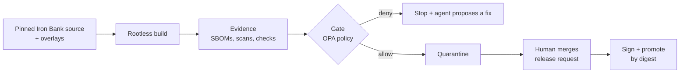
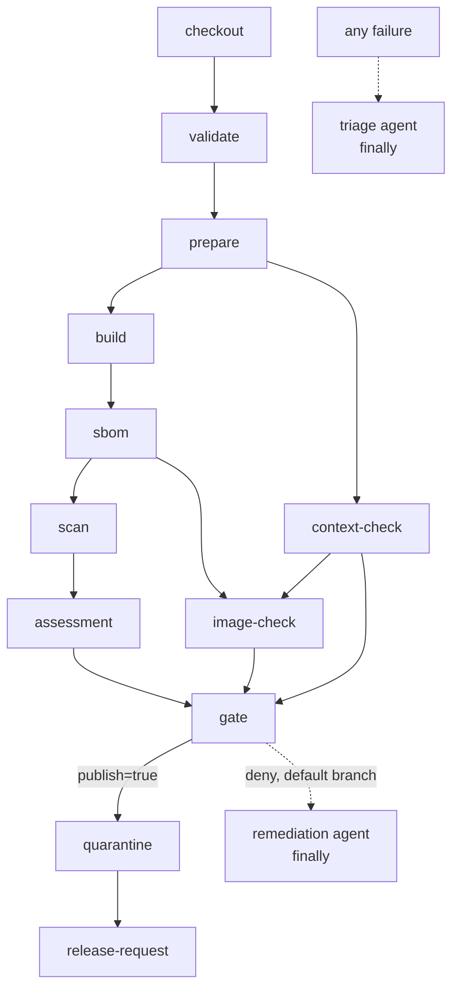
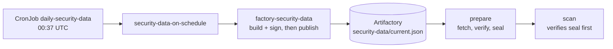
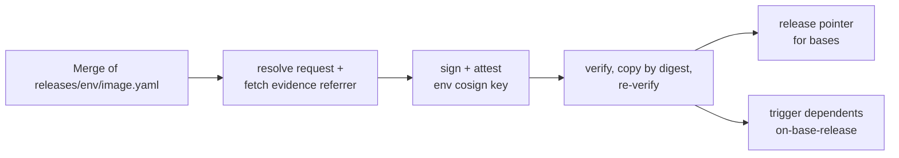
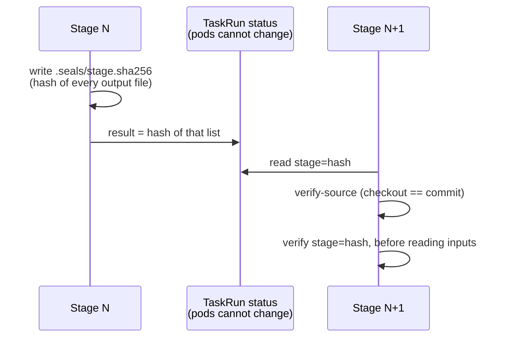
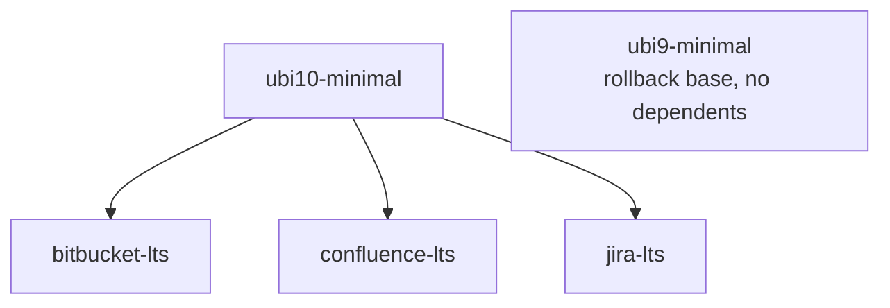

# Architecture

[Project overview](../README.md) · [Scope](scope.md) · [Base images](base-images.md) · [Agents](agents.md) · [Configuration](configuration.md) · [Operations](operations.md) · [Evidence model](evidence-model.md)

## What this system does

The factory rebuilds pinned Iron Bank sources without root privileges, collects
evidence about the result, and lets a policy decide whether the image may be
released. Released images are signed and copied by digest, so the bytes never
change after the decision.

| Part | Role |
|---|---|
| [Tekton](https://tekton.dev/docs/pipelines/) | runs the pipelines |
| [Pipelines-as-Code](https://pipelinesascode.com/docs/) (PaC) | starts them from Git events and webhooks |
| [Open Policy Agent](https://www.openpolicyagent.org/docs/) (OPA) | makes the release decision |
| Claude Code agents | help with operations; cannot publish, sign, approve, or merge |

**Candidate:** one built image, identified by its OCI digest (`sha256:...`).
**Evidence:** files describing a candidate (SBOMs, scanner reports, the gate
result). **Gate:** the OPA check that allows or denies release.

## Triggers

Every trigger is a PipelineRun file in `.tekton/`, generated from the catalog by
`factory/tekton.py` (`make tekton-render`). PaC reads them **only from the
default branch** (`pipelinerun_provenance: default_branch`; see the
[Repository CR guide](https://pipelinesascode.com/docs/guides/repository-crd/)),
so a merge request cannot add or edit a trigger to reach protected credentials.
GitLab merge requests and GitHub pull requests are both the event
`pull_request`.

| PipelineRun | Started by | Pipeline | Publishes |
|---|---|---|---|
| `<image>-on-pull-request` | PR touching the image's catalog entry, overlays, or shared build code | `factory-image-build` | no |
| `<image>-on-push` | the same paths merged to `main` | `factory-image-build` | quarantine + release request |
| `<image>-on-schedule` | nightly CronJob | `factory-image-build` | no (re-gate; a deny goes to the remediation agent) |
| `<image>-on-base-release` | release pipeline, after the image's base was promoted (application images) | `factory-image-build` | quarantine + release request |
| `factory-checks-on-pull-request` | every PR | `factory-checks` | no |
| `release-on-push` | merge touching `releases/**` | `factory-image-release` | sign + promote |
| `intake-on-schedule` | weekday CronJob | `factory-intake` | signed resource locks |
| `security-data-on-schedule` | daily CronJob | `factory-security-data` | signed security-data bundle |
| `agent-upstream-sync-on-schedule` | weekday CronJob | `factory-agent-maintenance` | draft PR |
| `agent-exception-steward-on-schedule` | weekly CronJob | `factory-agent-maintenance` | draft PR |
| `agent-pipeline-review-on-pull-request` / `-on-comment` | PR touching trust-boundary paths, or a `/review` comment | `factory-agent-maintenance` | PR comment |

`<image>` is one of the five catalog images: `ubi9-minimal`, `ubi10-minimal`,
`bitbucket-lts`, `confluence-lts`, `jira-lts`.

Kubernetes CronJobs (`deploy/base/schedules.yaml`) start scheduled runs by
calling the PaC [incoming webhook](https://pipelinesascode.com/docs/advanced/incoming-webhooks/)
with the PipelineRun name. Times are in [operations.md](operations.md#day-2-cadence).

## Build pipeline

| Stage | What it does |
|---|---|
| validate | checks the catalog and the image definition |
| prepare | applies overlay patches, checks the signed resource lock, fetches and verifies the [security-data bundle](#offline-security-data) |
| context-check | renders the product's templates with its own helper and checks the result statically ([base-images.md](base-images.md#context-check-after-prepare)) |
| build | rootless BuildKit build of the OCI archive |
| sbom | Syft CycloneDX and SPDX SBOMs, plus `sbom.identity.json` (the digest they describe and their hashes) |
| image-check | reads the OCI archive and checks user, entrypoint, ports, volume, files, and runtimes without running it ([base-images.md](base-images.md#image-check-after-sbom)) |
| scan | Grype, Trivy, OSV-Scanner; writes normalized findings and the assessment status ([evidence-model.md](evidence-model.md#how-the-scan-stage-works)) |
| assessment | fails unless scan wrote an assessment status file |
| gate | builds the gate input and evaluates the OPA policy |
| quarantine | imports the candidate and attaches its evidence (`publish=true` only) |
| release-request | opens the release request with the `release-readiness` briefing |

- **Scan may fail without failing its task** (`allow-failure: "true"`), which
  keeps its evidence for the agents. Assessment then fails if nothing was
  written, so a broken scan still stops the run. A gate deny fails the run.
- **What the pipeline never does:** sign or promote, run the candidate image, or
  do compliance scanning, malware scanning, or runtime tests. Those belong to the
  consuming environment ([scope.md](scope.md)).
- **Agents in `finally`:** Tekton runs [`finally` tasks after all others, pass or
  fail](https://github.com/tektoncd/pipeline/blob/v1.15.0/docs/pipelines.md#adding-finally-to-the-pipeline).
  `failure-triage` runs when any task failed; `cve-remediation` when the gate
  failed on a default-branch or scheduled run.

## Offline security data

The scan stage has no internet access. It reads a signed bundle of scanner
databases and the CISA KEV (Known Exploited Vulnerabilities) catalog.

| Step | Where | What |
|---|---|---|
| Build and sign | `factory-security-data`, intake permission group; `build_security_bundle.sh` | builds the bundle, signs it with the intake cosign key |
| Publish | same Task; `publish_security_bundle.sh` | uploads the bundle, then moves the `current.json` pointer |
| Fetch and verify | each build's prepare; `fetch_security_bundle.sh` | checks the SHA-256 against the pointer and the cosign signature, unpacks to `work/<image>/security-data/`, checks every file against the bundle manifest |
| Seal | prepare | seals the bundle as `security-data`; scan verifies that seal before reading |

Contents and freshness rules: [security-data/README.md](../security-data/README.md).

## Release pipeline

The request pins three values: the candidate digest, the evidence bundle's
manifest digest, and the bundle's SHA-256. `fetch_evidence_bundle.sh` refuses
evidence not attached to that digest or with different bytes, so the pipeline
signs exactly the evidence the gate saw.

Before and after copying, `promote_image.sh` runs `verify_release_evidence.sh`.
It requires one signed, approving gate attestation and a signed
`delegated-scanners` decision with `assessmentPassed: true` for the same
digest, and rejects any other scanner backend.

## Trust classes

A **trust class** is a group of tasks that share one ServiceAccount, one set of
NetworkPolicy egress rules, and the same allowed secrets. Generated PipelineRuns
assign ServiceAccounts through
[`taskRunSpecs`](https://github.com/tektoncd/pipeline/blob/v1.15.0/docs/pipelineruns.md#specifying-taskrunspecs);
NetworkPolicies select pods by their `tekton.dev/pipelineTask` label. A secret
is mounted only into the one step that uses it.

| Class | Tasks | Secrets | Egress |
|---|---|---|---|
| offline | checkout, validate, sbom, scan, assessment, gate, dependents | none (dependents: the PaC incoming secret) | git host (checkout); PaC controller (dependents) |
| internal-read | prepare, resolve, evidence-context | Artifactory read, intake public key | Artifactory, mirrors |
| buildkit | build | Artifactory read | Artifactory |
| import | quarantine | quarantine write | Artifactory |
| signing | attest | environment cosign key, referrer write | Artifactory |
| promotion | promote | release write, pointer write | Artifactory |
| intake | intake, security-data, upstream-context | intake write and signing key; mirror push (intake) | approved upstreams |
| agent | triage, remediation, release-request, maintenance | LLM gateway; SCM bot and PaC token in separate steps | gateway, git host |

`deploy/base/admission-policy.yaml` is a
[ValidatingAdmissionPolicy](https://kubernetes.io/docs/reference/access-authn-authz/validating-admission-policy/).
It allows a write, signing, release, mirror, SCM-bot, or incoming-webhook secret
only in pods whose PaC event type is `push` or `incoming`. Every other event
(`pull_request`, `Merge Request`, comment retests, or no marker) is refused. It
checks the pod after Tekton has filled in every parameter.

## Sealing stage outputs

All tasks in a PipelineRun share one workspace volume, so a later task could
rewrite an earlier task's evidence. Sealing makes that detectable.

Details: the seal is `work/<image>/.seals/<stage>.sha256`; the first step of
every later stage runs `artifacts.sh verify-source` and `artifacts.sh verify
<stage>=<hash>` for each input. Results are Tekton
[results](https://github.com/tektoncd/pipeline/blob/v1.15.0/docs/tasks.md#emitting-results).

Stages seal outputs even when they fail, so agents can read them. Prepare writes
two seals: `prepare` (build context and lock) and `security-data` (the verified
bundle, checked only by scan).

## Signatures and provenance

| Source | What it signs | Key |
|---|---|---|
| Factory attestations (`factory-attest`, `sign_and_attest.sh`) | a cosign signature plus statements for the resource lock, both SBOMs, build provenance, findings, gate result, scanner decision, the raw Grype, Trivy, and OSV reports, and the approval | per-environment key |
| Tekton Chains | the image, plus provenance for TaskRuns and PipelineRuns. `factory-quarantine` and `factory-promote` emit `IMAGE_URL`/`IMAGE_DIGEST` [type-hinted results](https://github.com/tektoncd/chains/blob/v0.28.0/docs/slsa-provenance.md) | held only by the Chains controller |

`deploy/chains/chains-config.yaml` selects `slsa/v2alpha3`, which
[Chains documents](https://github.com/tektoncd/chains/blob/v0.28.0/docs/config.md)
as SLSA v1.0 provenance for Tekton `v1` objects. The similarly named `slsa/v1`
is an alias of the older `in-toto` v0.2 format.

## Build and runtime model

- **Rootless BuildKit** runs in each build step with the `native` snapshotter
  and `--oci-worker-no-process-sandbox`
  ([rootless mode](https://github.com/moby/buildkit/blob/v0.33.0/docs/rootless.md)).
  It needs neither a pod user namespace nor an unmasked `/proc`, which keeps it
  within Kubernetes 1.28 and containerd 1.7.
- **Only the build run step** relaxes `allowPrivilegeEscalation`, seccomp, and
  AppArmor, and keeps `CAP_SETUID`/`CAP_SETGID` in its bounding set for the
  `newuidmap`/`newgidmap` file capabilities. Details:
  [configuration.md](configuration.md#user-namespace-helpers).
  `runtime_preflight.sh` checks this before the build.
- **No step** is privileged, uses host namespaces or host paths, or runs a
  container engine.
- **Source policy:** BuildKit denies remote image, HTTP, and Git sources. Every
  input is a digest-verified local OCI layout or a locked file.
- **Scanners** read the OCI archive directly (Syft and Trivy on the archive,
  Grype on the Syft SBOM); nothing unpacks the image filesystem.

## Image dependency model

Application builds use the base in the release pointer
(`releases/<base>/current.json`, written by the release pipeline). Promoting a
base starts each dependent's `<image>-on-base-release` run.

## Agents

See [agents.md](agents.md). Personas live in `.claude/agents/`. CI runs them
with `claude --bare -p`
([bare mode](https://code.claude.com/docs/en/headless#start-faster-with-bare-mode))
in `dontAsk` mode, with turn and budget caps and JSON-Schema-checked output, in
pods that hold only an LLM gateway token. A separate step re-checks any
proposal against a fresh clone of the pinned commit before a bot opens a draft
change request.
