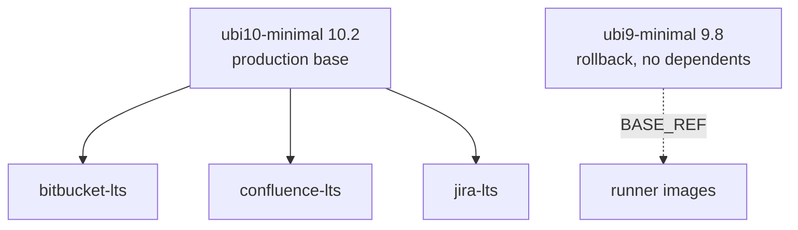
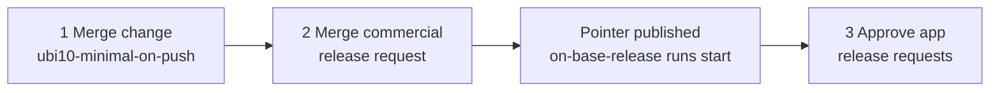
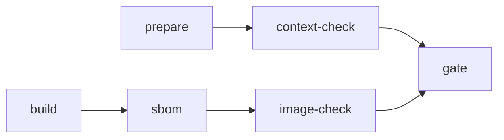

# Base images and static verification

[Project overview](../README.md) · [Scope](scope.md) · [Architecture](architecture.md) · [Evidence model](evidence-model.md)

## Bases

| Base | Iron Bank path | Role |
|---|---|---|
| `ubi10-minimal` | `redhat/ubi/10.x/ubi10-minimal` | Production base for the Atlassian LTS images |
| `ubi9-minimal` | `redhat/ubi/9.x/ubi9-minimal` | Previous base, still built, scanned, and releasable for rollback. Also the `BASE_REF` of the runner images (`toolchain/Containerfile.factory-runner`), so move the runner to UBI 10 before retiring it |

Apps take their base from `build.base.image` in their catalog entries. The
overlays keep both majors working (`ARG BASE_MAJOR`, passed by
`scripts/build_image.sh` from the base's `product.version`).

**Roll an app back to UBI 9:** point its `build.base.image` at `ubi9-minimal`
and set the manifest `BASE_IMAGE`/`BASE_TAG` back in the `0001` overlay.
`validate_context.py` rejects a manifest that names a different base than the
catalog.

### Bootstrapping the UBI 10 base

Application builds on the default branch read `releases/ubi10-minimal/current.json`.
That pointer is published only when a base with dependents is promoted in the
pointer environment (`FACTORY_POINTER_ENVIRONMENT`, commercial).

Until step 2, application builds fail in prepare because the pointer does not
exist. Each image runs in its own PipelineRun, so an app run cannot use a base
built by another run.

## What changes with UBI 10

Checked against the UBI 10 BaseOS/AppStream metadata when the change was made.
Re-check when bumping the base.

| Area | UBI 9 | UBI 10 | Handling |
|---|---|---|---|
| Python | 3.9 | 3.12 | entrypoint and helpers compile under the runner's 3.12 (`context-check`) |
| Jinja2 (`python3-jinja2`) | 2.11.3 | 3.1.6 | the runner pins 3.1.6, so templates render with the image's version; `jinja2-parity` warns on drift. Patched templates also render under 2.11.3 (rollback) |
| Java | `java-21-openjdk-headless` | same; Java 25 also available, 17 not | stay on Java 21 for the Atlassian LTS lines |
| JDK paths | `/usr/lib/jvm/jre-21-openjdk` made by alternatives scriptlets | listed in the package | `image-check` resolves Bitbucket's `JRE_HOME`/`JAVA_BINARY` in the built image either way |
| zlib | `zlib-devel` | `zlib-ng-compat-devel` (provides `zlib-devel`) | Bitbucket overlay `0004` names the real package for install and removal |
| System git | 2.52 | 2.52 | unsupported by Bitbucket on both; Bitbucket builds git 2.49.1 from source, and `image-check` fails if a banned git RPM appears |
| `cups-libs`, `avahi-libs` | removed upstream on UBI 9 | required by Java 21 | already preserved by the `0003` overlays |
| CA trust before RPM access | overlay `0002` | same need | `ubi10-minimal` overlay `0002` runs `update-ca-trust` before `microdnf` |
| CPU baseline | x86-64-v2 | RHEL 10 raises it (not verified here) | confirm nodes support it before rollout; `grep -c avx2 /proc/cpuinfo` is a quick proxy for x86-64-v3 |
| Crypto policy | Iron Bank STIG fixes | same (`configure_crypto_policy`) | runtime TLS to older databases or proxies may need review in the consuming environment |

## Static verification stages

Both stages are offline, hold no credentials, never run the candidate image, and
fail the PipelineRun only on `required` checks. Results are sealed evidence
(`evidence/context-check/result.json`, `evidence/image-check/result.json`) and
travel in the evidence bundle. Expectations live in the catalog `verify` block,
which agents cannot edit.

### context-check (after prepare)

Renders each product's own Jinja templates with its own `entrypoint_helpers.py`
(run in an isolated child Python with a minimal environment), using the
Dockerfile `ENV` defaults plus scenario overrides, then parses and asserts the
result. Scenarios come from Atlassian's `docker-atlassian-*` test suites,
limited to features the Iron Bank templates have.

| Check | Severity | Origin |
|---|---|---|
| entrypoint and helpers compile | required | n/a |
| server.xml defaults (connector port equals the first `verify.ports`) and proxy parameters | required | Atlassian `test_server_xml_defaults`/`_params` |
| Jira dbconfig per database type, schema names | required | Atlassian `test_dbconfig_xml_*` |
| JDBC URL and password containing `&`, `<`, `>`, or quotes (raw, pre-escaped, or mixed) render valid XML with the intended value | required | Atlassian `test_confluence_xml_postgres_ampersand*`, extended |
| Jira cluster.properties, seraph, S3 filestore; Confluence cfg, init properties, seraph | required | Atlassian `test_cluster_properties_*`, `test_seraph_*`, `test_filestore_*` |
| `unset_secure_vars` keeps `AWS_WEB_IDENTITY_TOKEN_FILE`, exact allowlisted names, and the password-cipher prefix family; removes secrets, including longer names that only start with an allowlisted one (where the entrypoint requests cleanup) | required | Atlassian `test_*_secure_vars`, tightened |
| Bitbucket git version not banned or unsupported (2.48, 2.51 to 2.54) | required | Atlassian `bin/git-versions.py` |
| Jinja2 major.minor matches the base | advisory | n/a |

### image-check (after sbom)

Reads `image.oci.tar` directly: the image config plus each layer's tar headers,
streamed one layer at a time and merged with OCI whiteouts and opaque directories
(which hide lower layers only, whatever the member order). It follows symlinks
such as the RHEL alternatives chain.

| Check | Severity |
|---|---|
| `User` resolves through the image's `/etc/passwd` to `verify.runUid`, non-root; `RUN_USER`/`RUN_UID` match | required |
| Entrypoint and Cmd, exposed ports, home volume, home owned by the run user | required |
| `verify.requiredPaths` present, entrypoint executables executable, `verify.forbiddenPaths` absent (build tarballs, `.obr`, git sources) | required |
| `java` and `python3` on `PATH`, Jinja2 installed, `verify.envPaths` resolve | required |
| Bitbucket: no git RPM in a banned version (SBOM) | required |
| Install dir `0550`; `logs`, `work`, `temp` `0770` owned by the run user | advisory (Atlassian parity) |
| Entrypoint files and support scripts root-owned, not writable by the run user | advisory (Atlassian parity) |
| Support-script tools present (`getopt`, `su`, `top`, `nc`, `which`) and `$JAVA_HOME/bin/jcmd` | advisory (Atlassian parity) |
| Image Jinja2 (SBOM) matches the version the templates were tested with | advisory |

Iron Bank differs from Atlassian's own images on the advisory items (for example
a `0755` install directory owned by the app user, no `JAVA_HOME`, no
procps-ng/util-linux). Changing them is a hardening decision. Promoting an
advisory check to required is a catalog or code change reviewed like policy.

### Overlay fixes that the checks guard

| Patch | Fixes | Upstream source |
|---|---|---|
| `jira-lts/0004`, `confluence-lts/0005` `keep-irsa-token-env` | `unset_secure_vars` removed `AWS_WEB_IDENTITY_TOKEN_FILE`, breaking EKS IRSA for S3 and Secrets Manager. Allowlist entries match exact names (upstream matches prefixes, so allowing `MY_TOKEN` also kept `MY_TOKEN_SECRET`); only the `com_atlassian_db_config_password_ciphers_algorithm_javax_crypto*` family is a prefix | shared-components CLIP-1824 (2023), tightened |
| `jira-lts/0005`, `confluence-lts/0006` `escape-jdbc-ampersands` | a `&` or `<` in the JDBC URL or password produced invalid `dbconfig.xml`/`confluence.cfg.xml` (autoescape never matches `*.xml.j2`). The five XML entities are decoded (`&amp;` last), then escaped, so any value that rendered valid XML before parses to the same string; only numeric references such as `&#38;` change | Confluence upstream template, generalised |
| `bitbucket-lts/0004` `ubi10-zlib-package-name` | `zlib-devel` is only a Provides on UBI 10 | n/a |
| `ubi10-minimal/0002` `update-ca-trust-before-rpm-access` | private-mirror TLS before the first `microdnf` call | mirrors `ubi9-minimal/0002` |

## Not covered here

Anything that needs the product running belongs to the consuming environment
([scope.md](scope.md)): JVM arguments, start-up and first-run state, shutdown,
thread and heap dumps, arbitrary-UID start, and Atlassian's end-to-end smoke
tests.
