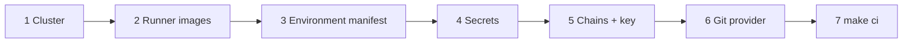
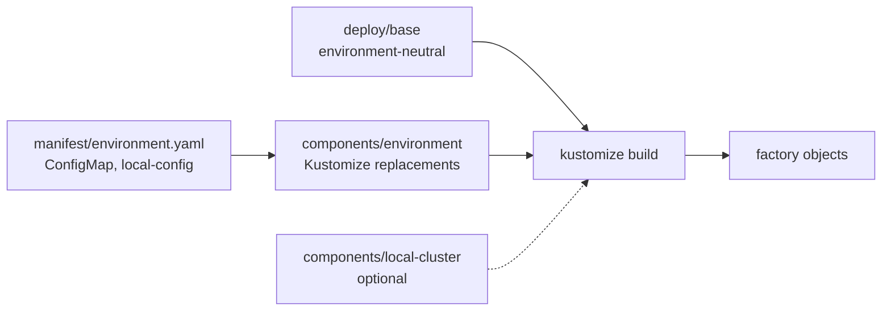
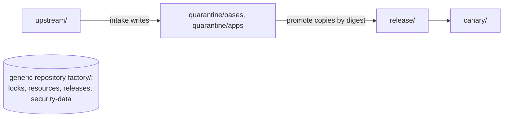
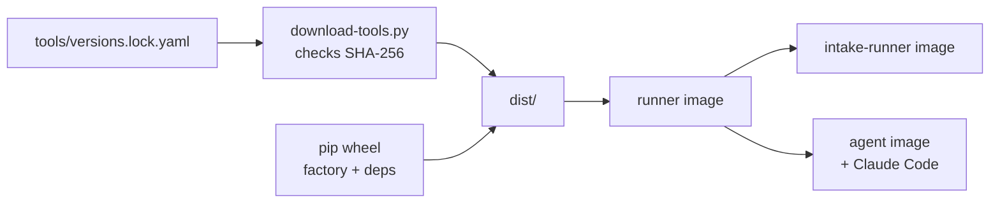
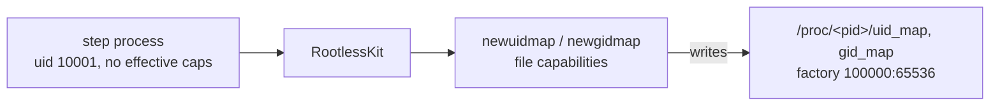

# Configuration reference

[Project overview](../README.md) · [Scope](scope.md) · [Operations](operations.md) · [Agents](agents.md) · [Architecture](architecture.md)

**PaC** is [Pipelines-as-Code](https://pipelinesascode.com/docs/), which starts
Tekton pipelines from Git events. A **Repository CR** is the Kubernetes object
that connects a Git repository to PaC.

## Quick setup checklist



1. **Cluster** (versions in `tools/versions.lock.yaml`)

   | Need | Detail |
   |---|---|
   | Kubernetes 1.28+, containerd 1.7+ | No pod user namespaces, `procMount`, or `appArmorProfile` field are used ([BuildKit](#buildkit)). |
   | ValidatingAdmissionPolicy | Beta on 1.28. Start kube-apiserver with `--feature-gates=ValidatingAdmissionPolicy=true` and `--runtime-config=admissionregistration.k8s.io/v1beta1=true`. The manifest uses `v1beta1`; on 1.30+ change both objects to `v1`. Without the API the deploy fails instead of running unprotected. |
   | Build nodes that allow unprivileged user namespaces | Ideally a dedicated, tainted pool. |
   | [Tekton Pipelines](https://tekton.dev/docs/pipelines/) v1.15, Pipelines-as-Code v0.51, [Tekton Chains](https://github.com/tektoncd/chains/blob/v0.28.0/docs/config.md) v0.28 | |
   | Default StorageClass | For the per-run `volumeClaimTemplate` workspaces. |

2. **Runner images.** Build, sign, and publish three images; record their
   digests in the manifest ([Runner images](#runner-images)).
3. **Environment.** Copy `deploy/environments/example` to
   `deploy/environments/<env>`, fill in `manifest/environment.yaml`
   ([Environment manifest](#environment-manifest)), then
   `kubectl apply -k deploy/environments/<env>`.
4. **Secrets.** Create those in `deploy/secrets.example.yaml` with your secret
   manager ([Secrets](#secrets)).
5. **Chains.** `kubectl apply -k deploy/environments/<env>/chains`, plus a
   signing key (KMS recommended).
6. **Git provider** ([below](#connect-the-git-provider)).
7. **Contributors** can run `make ci` locally.

### Connect the git provider

1. Create a project or group access token (`api` scope) and a webhook secret.
   Store both in Secret `factory-gitlab-webhook`.
2. Add a webhook to the PaC controller URL for **Merge request, Push, Comments,
   and Tag push**. `tkn pac create repo` does this, or use Settings > Webhooks
   ([PaC GitLab setup](https://pipelinesascode.com/docs/install/gitlab/)).
3. Protect `main`: merge requests only, required approvals, and code-owner
   approval, so `CODEOWNERS` governs `releases/` and the trust-boundary paths.
   Code-owner approval is a GitLab Premium feature; without it, limit who may
   merge.
4. Make the factory bot a project member. Merge requests from members start
   runs automatically; anyone else needs `/ok-to-test` from a member.

PaC's `settings.policy` is not used: it applies to GitHub and Forgejo only.
PaC and the generated PipelineRuns call both GitLab merge requests and GitHub
pull requests `pull_request`.

## Environment manifest

Everything that differs between installations lives in one file per environment:
`deploy/environments/<env>/manifest/environment.yaml`. That covers server names,
git provider and project, Artifactory host and repositories, UBI mirror, PaC
URL, LLM gateway, runner digests, approvers, egress CIDRs, and the Chains
builder ID. `deploy/base`, `deploy/chains`, the Tasks, and the scripts hold no
environment values; fields that need one say `from-environment`.



```text
deploy/
  base/                 environment-neutral factory objects
  chains/               environment-neutral Chains config
  components/
    environment/        copies manifest keys into the objects that use them
    local-cluster/      single-node profile: no NetworkPolicies, agents off
  environments/
    example/            placeholders, production-shaped
    dev/                dev GitLab and Artifactory, single-node cluster
    local/              GitHub, local registry and file shim, upstream Iron Bank
      manifest/environment.yaml   documents every key
      kustomization.yaml          kubectl apply -k deploy/environments/<env>
      chains/                     kubectl apply -k deploy/environments/<env>/chains
```

Kustomize reads the manifest but never applies it. Where each key goes:

| Manifest keys | Filled into |
|---|---|
| Settings keys: `ARTIFACTORY_*`, `FACTORY_*_REPOSITORY`, `INTERNAL_GIT_BASE_URL`, `FACTORY_SOURCE_MODE`, `FACTORY_UBI_MIRROR_URL`, `FACTORY_PAC_CONTROLLER_URL`, `FACTORY_GITLAB_API_URL`, `SCM_BOT_AUTHOR_*`, `ANTHROPIC_BASE_URL`, `CISA_KEV_URL`, `FACTORY_GOV_APPROVER_PATTERN` | ConfigMap `factory-settings`, same name |
| `GIT_PROVIDER`, `GIT_PROVIDER_URL`, `GIT_REPOSITORY_URL` | Repository CR (`spec.git_provider.type`, `.url`, `spec.url`) and the `git_provider` param |
| `RUNNER_IMAGE`, `INTAKE_RUNNER_IMAGE`, `AGENT_IMAGE` | Repository CR image params; `RUNNER_IMAGE` also runs the schedule CronJobs |
| `*_CIDR` | Egress NetworkPolicies |
| `CHAINS_BUILDER_ID` | `chains-config` `builder.id` |

To add an environment, copy `example` and edit only its manifest. Add
`../../components/local-cluster` to `components` for a single-node cluster.
Secrets never go in the manifest. `tests/unit/test_deploy_overlays.py` fails if
a key is missing or unused, a build leaves a `from-environment` placeholder, or
a value unique to one environment appears in a tracked file outside its
directory.

### Source mode

`FACTORY_SOURCE_MODE` chooses where intake and prepare clone Iron Bank from.

| Value | Clone from | Use |
|---|---|---|
| `mirror` (default) | `INTERNAL_GIT_BASE_URL` + catalog `source.mirrorPath` | production, `dev` |
| `upstream` | catalog `source.upstream` directly; `mirror_sources.sh` does nothing | `local` |

The checkout must match the pinned SHA in both modes: the mode changes the
route, not the trust.

## Pipelines-as-Code Repository

`deploy/base/repository.yaml`:

| Field | Value | Why |
|---|---|---|
| `url` | `GIT_REPOSITORY_URL` | which project's webhooks this namespace serves |
| `git_provider` | `GIT_PROVIDER`, `GIT_PROVIDER_URL`; Secret `factory-gitlab-webhook` keys `provider.token`, `webhook.secret` | API access and webhook validation |
| `settings.pipelinerun_provenance` | `default_branch` | merge-request runs use PipelineRuns from `main`, never from the merge request |
| `concurrency_limit` | `3` | each run holds a volume and up to 8 CPUs |
| `params` | `runner_image`, `intake_runner_image`, `agent_image`, `git_provider`, `enable_agents` | digest-pinned images, provider, and the agent switch, filled into generated PipelineRuns |
| `incoming` | `webhook-url`, Secret `factory-pac-incoming`, target `main` | lets CronJobs and the release pipeline start runs |

See the PaC docs for [the Repository CR](https://pipelinesascode.com/docs/guides/repository-crd/) and
[incoming webhooks](https://pipelinesascode.com/docs/advanced/incoming-webhooks/).

## Settings

ConfigMap `factory-settings` is passed to every step as environment variables.
*env* keys come from the manifest; the rest are shared defaults in
`deploy/base/settings.yaml`.

| Key | Purpose |
|---|---|
| `INTERNAL_GIT_BASE_URL` (*env*) | SCM namespace holding the source mirrors |
| `FACTORY_SOURCE_MODE` (*env*) | `mirror` or `upstream` ([Source mode](#source-mode)) |
| `ARTIFACTORY_URL`, `ARTIFACTORY_REGISTRY` (*env*) | Artifactory API base URL and OCI registry host |
| `ARTIFACTORY_USERNAME` (*env*) | registry login paired with the `factory-artifactory-*` tokens; REST calls send the token as a bearer and need no name |
| `FACTORY_SOURCE_REPOSITORY` (*env*) | generic repository for locks, intake files, release pointers, security-data bundle |
| `UPSTREAM_OCI_REPOSITORY` (*env*) | digest-pinned upstream base images |
| `FACTORY_{BASE,APPLICATION}_QUARANTINE_REPOSITORY` (*env*) | candidate repositories; the catalog `publication.quarantineRepository` expands these |
| `FACTORY_RELEASE_REPOSITORY`, `FACTORY_CANARY_REPOSITORY` (*env*) | release and canary repositories; the catalog `publication.releaseRepository` expands these |
| `FACTORY_CATALOG_DIR` | `catalog/images` |
| `FACTORY_UBI_MIRROR_URL` (*env*) | mirror of the public UBI RPM content, same layout as `https://cdn-ubi.redhat.com/content/public/ubi/dist`. Builds read `ubi<major>/<major>/<arch>/{baseos,appstream}/os` under it with Secret `factory-rpm-mirror` |
| `FACTORY_DEFAULT_BRANCH` | branch that scheduled runs and agent change requests target |
| `FACTORY_GOV_APPROVER_PATTERN` (*env*) | regex the merging approver must match for gov1/gov2 |
| `FACTORY_POINTER_ENVIRONMENT` | environment whose base releases update the release pointer (`commercial`) |
| `CISA_KEV_URL` (*env*) | [CISA KEV](https://www.cisa.gov/known-exploited-vulnerabilities-catalog) JSON feed, used when building the security-data bundle |
| `FACTORY_UPSTREAM_BRANCH` | Repo One branch followed by intake and upstream-sync |
| `FACTORY_PAC_CONTROLLER_URL` (*env*), `FACTORY_PAC_REPOSITORY` | PaC incoming endpoint and Repository CR name |
| `FACTORY_GITLAB_API_URL` (*env*) | API for agent comments and merge requests; defaults to `https://<git host>/api/v4` (`FACTORY_GITHUB_API_URL` applies only when `git_provider` is `github`) |
| `SCM_BOT_AUTHOR_NAME`, `SCM_BOT_AUTHOR_EMAIL` (*env*) | commit identity for agent proposals and release requests |
| `ANTHROPIC_BASE_URL` (*env*) | Anthropic-format [LLM gateway](https://code.claude.com/docs/en/llm-gateway) |
| `ANTHROPIC_DEFAULT_SONNET_MODEL`, `_OPUS_MODEL` | optional gateway names for the `sonnet`/`opus` aliases ([model config](https://code.claude.com/docs/en/model-config)); to use them, add the key to the manifests and an entry to `deploy/components/environment` |
| `FACTORY_AGENT_TIMEOUT` | wall-clock limit per agent run |

## Artifactory layout

Scripts address Artifactory in two ways only, so any repositories work if both hold:

- **OCI:** `${ARTIFACTORY_REGISTRY}/${repository}/${path}:tag`, repository-path
  access. `${repository}` may contain a path (`<key>/<prefix>`). The subdomain
  method is not supported.
- **Files:** `${ARTIFACTORY_URL}/artifactory/${FACTORY_SOURCE_REPOSITORY}/<file>`,
  a generic repository with an optional prefix.

So the factory's logical repositories are path prefixes. Trust boundaries
between them are Artifactory permission targets (include patterns) with one
token each. The dev environment is a worked example on one docker and one
generic repository; `example` uses placeholder names.



| Setting | Dev prefix | Holds | Token (Secret) |
|---|---|---|---|
| runner images (`*_IMAGE`) | `<docker>/factory/` | three runner images, by digest | operator pushes; kubelet reads |
| `UPSTREAM_OCI_REPOSITORY` | `<docker>/upstream` | Iron Bank bases from intake | `-intake` write; `-read` read |
| `FACTORY_BASE_QUARANTINE_REPOSITORY` | `<docker>/quarantine/bases` | gated base candidates, evidence referrers | `-quarantine` write |
| `FACTORY_APPLICATION_QUARANTINE_REPOSITORY` | `<docker>/quarantine/apps` | gated application candidates | `-quarantine` write |
| `FACTORY_RELEASE_REPOSITORY` | `<docker>/release` | promoted images, signatures, attestations | `-release` write; `-sign` for signatures |
| `FACTORY_CANARY_REPOSITORY` | `<docker>/canary` | canary images (none today) | `-release` |
| `FACTORY_SOURCE_REPOSITORY` | `<generic>/factory` | `locks/`, `resources/`, `releases/<image>/current.json`, `security-data/` | `-intake` locks, resources, bundle; `-pointer` pointers; `-read` read |
| `FACTORY_UBI_MIRROR_URL` | `https://<host>/artifactory/<UBI remote>/content/public/ubi/dist` | remote repository in front of the UBI CDN | `factory-rpm-mirror` read |

All tokens are Secrets named `factory-artifactory-<suffix>`. Permission targets:

| Target | Repository | Include pattern | Permission | Token |
|---|---|---|---|---|
| factory-read | docker, generic, UBI remote | `**` | read | `-read`, `factory-rpm-mirror` |
| factory-intake | docker | `upstream/**` | read, deploy | `-intake` |
| factory-intake | generic | `factory/locks/**`, `factory/resources/**`, `factory/security-data/**` | read, deploy | `-intake` |
| factory-quarantine | docker | `quarantine/**` | read, deploy | `-quarantine` |
| factory-sign | docker | `quarantine/**`, `release/**` | read, deploy (tags `sha256-*.sig`, `.att`) | `-sign` |
| factory-release | docker | `release/**`, `canary/**` | read, deploy | `-release` |
| factory-pointer | generic | `factory/releases/**` | read, deploy | `-pointer` |

No token can delete artifacts. Only the signature token crosses from
quarantine to release, and it writes signature and attestation tags next to an
existing digest.

**Anonymous read.** If the instance allows it (dev does), the read rows are
redundant; create only the deploy grants. One exclusion is required: remove
`quarantine/**` and `upstream/**` from the anonymous read on the docker
repository. Those hold ungated candidates and unvetted bases, and nobody should
be able to pull an unreleased image because its tag exists. `release/**`,
`canary/**`, and the generic repository can stay anonymously readable.

**What the layout cannot provide**

| Topic | Detail |
|---|---|
| RPM content | A *local* repository serves only uploads; builds need the UBI CDN layout (`ubi9/9/x86_64/baseos/os/…`) under `FACTORY_UBI_MIRROR_URL`. Use a *remote* repository in front of `https://cdn-ubi.redhat.com`; the catalog's `build.rpm.source: private-mirror` then applies. `factory-rpm-mirror` holds a bot account and token (Artifactory accepts a token as the basic-auth password). With no such repository, set `FACTORY_RPM_SOURCE_MODE: public-upstream` in `factory-settings`. `image-metadata.json` records `rpmSource` either way. |
| Environment separation | One `dev` repository per type is fine for development. Keep `commercial`/`gov1`/`gov2` and quarantine-to-release as separate repositories with separate write scopes unless one misconfigured permission target is an acceptable blast radius. |
| OCI referrers | `publish_evidence_bundle.sh` uses `oras attach`. Versions without the OCI 1.1 referrers API use oras's referrers-tag fallback. Signatures and attestations are ordinary tags. |
| Helm, PyPI | Not used. `deploy/` is Kustomize; `make toolchain` resolves Python dependencies on a connected host and bakes them into the runner. |

## Secrets

Names and keys are fixed by the Tasks (`deploy/secrets.example.yaml`). Each is
mounted only into the step that needs it.

| Secret | Keys | Used by |
|---|---|---|
| `factory-artifactory-read` | `token` | prepare, build, resolve, evidence-context |
| `factory-rpm-mirror` | `username`, `password` | build (read-only RPM mirror) |
| `factory-intake-cosign-public-key` | `cosign.pub` | prepare (lock and bundle verification) |
| `factory-artifactory-quarantine` | `token` | quarantine |
| `factory-artifactory-sign` | `token` | attest |
| `factory-artifactory-release` | `token` | promote |
| `factory-artifactory-pointer` | `token` | promote (pointer step) |
| `factory-cosign-{commercial,gov1,gov2}` | `cosign.key`, `password`, `cosign.pub` | attest, promote |
| `factory-artifactory-intake` | `token` | intake; security-data (publish) |
| `factory-intake-cosign` | `cosign.key`, `password`, `cosign.pub` | intake; security-data (build) |
| `factory-scm-mirror` | `username`, `token` | intake |
| `factory-scm-bot` | `username`, `token` | agent publish step (default branch only) |
| `factory-ai-gateway` | `token` | agent step |
| `factory-pac-incoming` | `secret` | incoming webhook, schedules, dependents |
| `factory-gitlab-webhook` | `provider.token`, `webhook.secret` | PaC provider (read by the PaC controller, not a Task) |

One cosign key pair per release environment
([key generation](https://docs.sigstore.dev/cosign/key_management/signing_with_self-managed_keys/)):

```bash
cosign generate-key-pair --output-key-prefix cosign-commercial
```

## Pipeline parameters

Each generated PipelineRun sets these `factory-image-build` parameters.
`factory/tekton.py` renders them; change it and run `make tekton-render`, never
the generated files.

| Param | PR | push | schedule | base-release |
|---|---|---|---|---|
| `publish` | false | true | false | true |
| `enable-agents` | `{{ enable_agents }}` from the Repository CR (default `"true"`) | same | same | same |
| `enable-remediation` | false | true | true | true |
| `enable-release-request` | false | true | false | true |

## Runner images

All three are built offline from a `dist/` directory that `make toolchain`
assembles on a connected host.



`download-tools.py` fetches each pinned binary from GitHub releases (cosign,
oras, BuildKit, RootlessKit, yq, OPA, Syft, Grype, Trivy, OSV-Scanner), the
shadow source archive, and with `--with-claude` the Claude Code binary. It
refuses any asset without a GitHub-recorded SHA-256. The wheel targets Python
3.12 on the runner.

| Image | Containerfile | Base | Adds |
|---|---|---|---|
| `runner_image` | `Containerfile.factory-runner` | `BASE_REF`: the internal UBI 9 minimal (or `registry.access.redhat.com/ubi9/ubi-minimal` for a connected dev build) | UBI packages (Python 3.12, Skopeo, git, jq, curl, libcap), pinned tools, the factory package, the `factory` user with subordinate IDs, and `newuidmap`/`newgidmap` built with libcap in a throwaway stage (needs `gcc`, `make`, `libcap-devel`, `glibc-devel`, `libxcrypt-devel`, `xz` from the UBI mirror) and installed with file capabilities. No container engine. |
| `intake_runner_image` | `Containerfile.factory-intake-runner` | runner | a tool check; a separate digest for the connected trust class |
| `agent_image` | `Containerfile.factory-agent` | runner | the pinned Claude Code binary |

No stage downloads anything at run time. Versions are pinned only in
`tools/versions.lock.yaml`. `skopeo` comes from UBI RPMs, so the runner build
checks it against the lock's major.minor (`dist/rpm-versions.txt`), and a
snapshot that moves it fails the build. Renovate tracks every GitHub pin but
leaves `skopeo` and Jinja2/MarkupSafe alone; those follow the UBI snapshot and
the release base's `python3-jinja2`. `tests/unit/test_pin_consistency.py`
enforces all of this.

### TLS-inspecting proxy or private CA

Export the proxy or CA root as PEM and set `FACTORY_CA_BUNDLE` before
`make toolchain` (macOS example):

```bash
security find-certificate -a -c "Zscaler Root CA" -p /Library/Keychains/System.keychain >~/zscaler-root.pem
openssl x509 -in ~/zscaler-root.pem -noout -subject      # sanity check
export FACTORY_CA_BUNDLE=~/zscaler-root.pem
make toolchain
```

| Where | Effect |
|---|---|
| Runner image | trusts the bundle |
| Each RUN step of an image being built | `scripts/build_image.sh` mounts the merged trust store at `/run/factory-ca-bundle.crt` (a BuildKit secret, not a layer) and points the repo config at it (`sslcacert`, `scripts/write_repo_config.sh`), so `dnf`/`microdnf` verify the proxy or mirror |
| Built image | untouched. Iron Bank Dockerfiles run `update-ca-trust`, which must rewrite `/etc/pki/ca-trust/extracted/pem/tls-ca-bundle.pem`, and the extra root never ends up in the image |

Other TLS clients inside RUN steps are not covered, which matches Iron Bank's
rule that Dockerfiles fetch nothing at build time. Not needed when the internal
base already trusts the proxy or mirror CA.

## BuildKit

The build run step starts a short-lived rootless `buildkitd` inside the step
container (`scripts/run_buildkit.sh`, `--oci-worker-no-process-sandbox`). There
is no shared daemon, host socket, privileged sidecar, or container engine, and
nothing runs the candidate image ([scope.md](scope.md)).

Only the run step has these settings; every other step uses `RuntimeDefault`
seccomp with all capabilities dropped.

| Setting | Why |
|---|---|
| `allowPrivilegeEscalation: true`, `capabilities: {drop: [ALL], add: [SETUID, SETGID]}` | the ID-mapping helpers (below) |
| `seccompProfile: Unconfined` | the default profile blocks the `unshare` and `mount` calls RootlessKit makes; a `Localhost` profile allowing them can replace it |
| AppArmor `unconfined` via annotation `container.apparmor.security.beta.kubernetes.io/step-run` | `factory/tekton.py` renders it onto the build TaskRun (`taskRunSpecs[].metadata.annotations`). The `appArmorProfile` field exists only from 1.30; the annotation still works there |

It does not use pod user namespaces (`hostUsers: false`) or
`procMount: Unmasked`; neither is available on 1.28 with containerd 1.7, and
the no-process-sandbox mode does not need them. The namespace's
[Pod Security](https://kubernetes.io/docs/concepts/security/pod-security-admission/)
level is therefore `privileged`, with `restricted` warnings and audit.

Nodes must allow unprivileged user namespaces:
`/proc/sys/user/max_user_namespaces` above zero, and on Ubuntu 23.10+
`kernel.apparmor_restrict_unprivileged_userns=0` or a permitting AppArmor
profile. `scripts/runtime_preflight.sh` writes these facts to
`evidence/runtime/runtime.txt` before every build.

### User-namespace helpers



- The helpers carry file capabilities as RHEL ships them: `newuidmap` has
  `cap_setuid=ep`, `newgidmap` has `cap_setgid=ep`. Neither is setuid, so
  nothing in the image runs with euid 0.
- A file capability applies only if it is in the caller's bounding set and
  `no_new_privs` is unset ([capabilities(7)](https://man7.org/linux/man-pages/man7/capabilities.7.html)).
  Hence the run step keeps `CAP_SETUID`/`CAP_SETGID` in the bounding set and
  allows privilege escalation. The capabilities exist only inside the helpers.
- The runner compiles the helpers from the pinned
  [shadow](https://github.com/shadow-maint/shadow) release with `libcap-devel`,
  which raises only the capability needed to write the map (`lib/idmapping.c`).
- Build the runner image with a builder that preserves `security.capability`
  extended attributes (BuildKit does). `runtime_preflight.sh` checks the
  bounding set, `no_new_privs`, and the helpers' file capabilities, and names
  what is missing.
- The map needs the subordinate range to exist in the node's user namespace.
  kind on rootless Podman has too few IDs, so builds fail there
  ([local-harness.md](local-harness.md)).

Pods share the host user namespace, so the build UID and its subordinate range
are real host UIDs. Use a dedicated, tainted node pool
([scope.md](scope.md#security-trade-off-accepted-with-this-scope)).

`FACTORY_BUILD_NETWORK` accepts `default` (production), `none`, or `host`
(explicit only).

## Tekton Chains

`deploy/chains/chains-config.yaml` (applied per environment through
`deploy/environments/<env>/chains`, which fills `builder.id` from
`CHAINS_BUILDER_ID`) sets:

- `slsa/v2alpha3` provenance for TaskRuns and PipelineRuns. In Chains v0.28 this
  produces SLSA v1.0 from Tekton `v1` objects. The similarly named `slsa/v1` is
  an alias of `in-toto` and produces the older SLSA v0.2
  ([Chains config](https://github.com/tektoncd/chains/blob/v0.28.0/docs/config.md)).
- OCI storage and no public transparency log.

Use a KMS signer in production. Chains signs the `IMAGE_URL`/`IMAGE_DIGEST`
results of the quarantine and promotion tasks with its own key. The factory's
environment keys still produce the attestations that gate release.

## Source pins and Renovate

- `vendir/config.yml` pins Repo One sources. `source.revision` and its vendir
  ref must move together (enforced for agent changes).
- `make update-pins` (`scripts/update_source_pins.sh`) updates pins by hand. The
  `upstream-sync` agent does the same, rebases overlays, and opens a PR.
- `renovate.json` updates `tools/versions.lock.yaml` (Tekton, PaC, Chains, tkn,
  Claude Code). Every update needs human review.

## Vulnerability exceptions

`policies/exceptions/approved.json` affects vulnerability-threshold denials
only, never evidence identity, data freshness, or signatures. Humans add
exceptions; the `exception-steward` agent may only propose removals.

## Cosign storage and promotion

Cosign 2.x stores signatures and attestations under tags derived from the image
digest. Promotion copies both OCI referrers (including the evidence bundle) with
`oras cp --recursive` and these tags with `cosign copy`.
