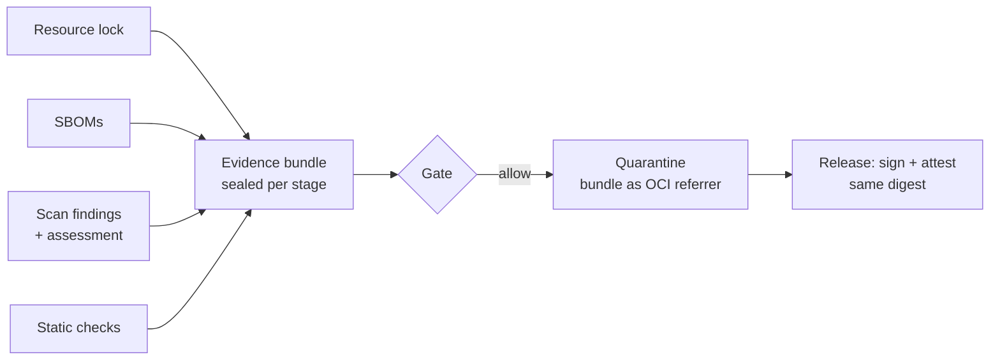
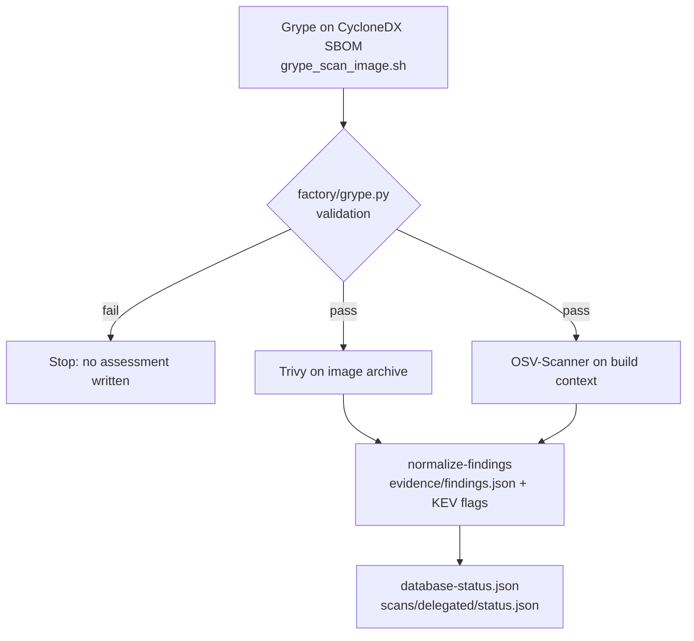

# Evidence model

[Project overview](../README.md) · [Scope](scope.md) · [Architecture](architecture.md) · [Operations](operations.md)

**Evidence** is the set of files describing one built image (the **candidate**).
Every piece names the candidate's image digest (`sha256:...`). If any piece names
a different digest, release stops.

## What a releasable candidate needs

- a signed resource lock (the exact upstream inputs)
- SBOMs in CycloneDX and SPDX format
- a scanner assessment and normalized vulnerability findings
- passing static checks: `evidence/context-check/result.json` and
  `evidence/image-check/result.json` (required checks pass; advisory results are
  kept, see [base-images.md](base-images.md))
- a gate result (the release policy decision)
- build provenance
- an approval (the merge of the release request)

Compliance scans (OpenSCAP), malware scans, and runtime tests are not part of
this evidence and not required for release ([scope.md](scope.md)). A consuming
environment that produces them can attest them to the same digest with its own
key.

## Signed attestations

At release, `scripts/sign_and_attest.sh` signs the candidate with
[cosign](https://docs.sigstore.dev/cosign/signing/overview/) and attaches each
item below as a signed statement about the digest.

| Attestation | Produced by | Contents |
|---|---|---|
| Resource lock | intake | source commit, resource URLs and checksums, OCI digests |
| CycloneDX SBOM | Syft (sbom stage) | OS packages and application dependencies |
| SPDX SBOM | Syft (sbom stage) | the same inventory in SPDX format |
| Provenance (`https://slsa.dev/provenance/v1`) | `scripts/generate_provenance.py` at signing time | source, base, resources, builder, output digest |
| Scanner decision (`delegated-scanners-decision`) | scan stage | backend, scanner identity, digest, `assessmentPassed`, Grype validation details |
| Raw scanner reports | scan stage | Grype, Trivy, and OSV-Scanner JSON; Syft version |
| Vulnerability findings | scan stage (`factory.cli normalize-findings`) | normalized findings from all scanners, with fix and KEV flags |
| Gate decision | gate stage (OPA) | `allow`, `deny[]`, `warn[]`, scanner backend, digest |
| Approval | release pipeline | approver (who merged the request), environment, digest, time |

Tekton Chains separately signs the image and stores provenance for the
quarantine and promotion runs with its own key
([architecture.md](architecture.md#signatures-and-provenance)).

## How the scan stage works

`scripts/scan_image.sh` reads only the offline
[security-data bundle](../security-data/README.md) that prepare verified and
sealed.

OSV-Scanner runs only when the build context contains a `go.mod`, `pom.xml`,
`package-lock.json`, or `requirements.txt`. Trivy and OSV-Scanner run offline.

### What makes Grype validation fail

Validation fails closed: any problem stops the scan stage.

| Problem | Detail |
|---|---|
| Invalid database | the Grype database is invalid, or its build time has no time zone |
| Malformed report | missing identity, matches, IDs, severities, package names, or well-formed fix versions |
| SBOM mismatch | generated for a different digest, or changed after generation (the sbom stage records the digest and both SBOM hashes in `evidence/sbom.identity.json`) |
| Stale KEV catalog | CISA `dateReleased` is older than `policy.maximumDatabaseAgeHours` (72 hours today) or in the future |
| Bad baseline | a baseline is present and signed, but its signature does not verify or it is not approved for this image |

### Effect on the run

1. `scan_image.sh` exits before Trivy and OSV-Scanner run; no assessment status
   is written.
2. The scan stage may fail, so its partial evidence is kept. The assessment
   stage then fails because the status is missing.
3. Tekton marks the PipelineRun failed and the gate never runs, so the candidate
   cannot be quarantined or released.
4. `failure-triage` runs. `cve-remediation` does not, because it runs only when
   the gate fails.

When validation passes, Trivy and OSV-Scanner feed the findings as usual.

### Baselines and "new" findings

A **baseline** lists findings a human already accepted for an image. A finding in
the baseline is "not new", which relaxes the rule that blocks new HIGH findings
(`policy.block.newHigh`).

- Only a signed baseline is used: `<image>.json`, its `.sig`, and a public key.
  An unsigned baseline is ignored with a warning.
- The scan stage applies a baseline to Trivy and OSV findings only when Grype
  verified it.
- Without a verified baseline, every finding from every scanner is new, so the
  gate may deny more often.
- No baselines ship today. The bundle from `scripts/build_security_bundle.sh`
  has no `baselines/` directory, so in the pipeline every finding is new.

### Database freshness

`evidence/database-status.json` records `generatedAt`: the **earlier** of the
bundle's `generated-at` time and the Grype database build time. The gate denies
when it is older than `policy.maximumDatabaseAgeHours` or in the future. That is
stricter than using the bundle time alone.

**Known risk:** CISA sets `dateReleased` when it last changed the KEV catalog,
not when the factory downloaded it. If CISA publishes no update for over 72
hours, every scan fails even with a fresh bundle. How to handle that is a human
policy decision ([security-data/README.md](../security-data/README.md#freshness)).

At release, `scripts/verify_release_evidence.sh` accepts only the
`delegated-scanners` backend.

## Gate decision

The gate (`policies/rego/factory/release/release.rego`) denies when any of these
is true:

- the SBOM is invalid;
- the candidate digest is invalid;
- the assessment did not pass, has the wrong scanner identity, or names a
  different digest;
- the vulnerability data is stale, missing, or from the future;
- a finding is blocked and not excepted (rules in the
  [`evidence-model` skill](../.claude/skills/evidence-model/SKILL.md)).

Warnings never cancel a deny. Exceptions in `policies/exceptions/approved.json`
apply only to vulnerability findings and never bypass identity, freshness, or
signatures.

## Moving evidence between stages and pipelines

| Hop | Mechanism |
|---|---|
| Within a PipelineRun | each stage writes a seal, a list of hashes of its outputs (`work/<image>/.seals/<stage>.sha256`); the hash of that list is a Tekton result; every later stage checks it before reading ([architecture.md](architecture.md#sealing-stage-outputs)) |
| Build to release | after quarantine import, the evidence directory is attached to the candidate as an OCI referrer (`publish_evidence_bundle.sh`). The release request pins the referrer's manifest digest and the archive's SHA-256; `fetch_evidence_bundle.sh` refuses anything else |

## Identity rules

- Attestations reference the exact candidate digest.
- Promotion keeps the digest and copies the evidence with it.
- `scripts/promote_image.sh` verifies evidence before and after the copy.
