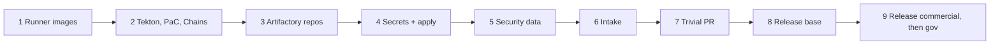
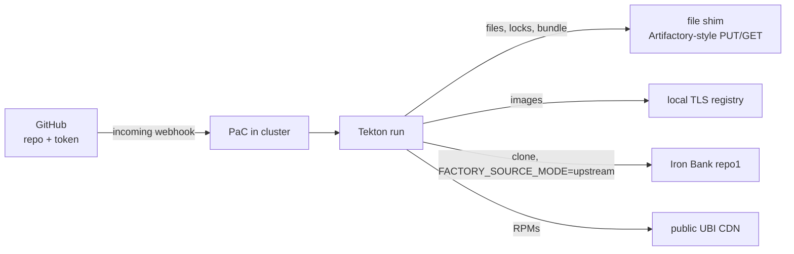
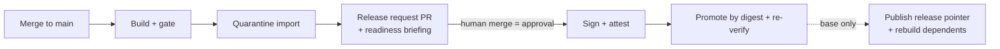
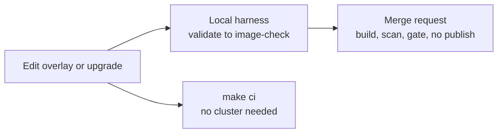

# Operations guide

[Project overview](../README.md) · [Scope](scope.md) · [Configuration](configuration.md) · [Architecture](architecture.md) · [Agents](agents.md) · [Evidence model](evidence-model.md)

**PaC** is Pipelines-as-Code, which starts the Tekton pipelines. The **gate** is
the OPA (Open Policy Agent) release policy. A **seal** is a list of SHA-256
hashes a stage writes for its outputs so later stages can detect changes
([architecture.md](architecture.md#sealing-stage-outputs)).

## Bootstrap sequence

1. On a connected host run `make toolchain`. Build and sign the runner,
   intake-runner, and agent images from `toolchain/`. Record their digests in
   `deploy/environments/<env>/manifest/environment.yaml`
   ([configuration.md](configuration.md#environment-manifest)).
2. Install Tekton Pipelines, PaC, and Tekton Chains; then
   `kubectl apply -k deploy/environments/<env>/chains`.
3. Create the Artifactory repositories for source, upstream OCI, quarantine,
   release, and canary content with separate write scopes
   ([configuration.md](configuration.md#artifactory-layout)).
4. Create the Secrets (`deploy/secrets.example.yaml`) and fill in the manifest.
   Let the `approved-upstreams` NetworkPolicy reach the Grype, Trivy, and OSV
   database mirrors and the CISA KEV feed. Then
   `kubectl apply -k deploy/environments/<env>`.
5. Build the first security-data bundle with
   `scripts/tekton/trigger_incoming.sh security-data-on-schedule`. Confirm
   `security-data/current.json` exists in `FACTORY_SOURCE_REPOSITORY`. Until it
   does, every build's prepare stage fails.
6. Run intake: `scripts/tekton/trigger_incoming.sh intake-on-schedule`. Confirm
   signed locks under `locks/<image>/<revision>/`. Both triggers need the
   `FACTORY_PAC_*` variables and the incoming secret.
7. Open a trivial PR (for example a comment in `catalog/images/jira-lts.yaml`)
   to run the PR pipeline end to end. Inspect the evidence in the TaskRun logs.
8. Merge it, then review the quarantine import and the release-request PR.
   Release the base (`ubi10-minimal`) to commercial first: its promotion
   publishes the release pointer every application build reads
   ([base-images.md](base-images.md#bootstrapping-the-ubi-10-base)).
9. Merge a **commercial** release request first. Enable gov1/gov2 only after the
   approver flow and environment keys are verified.

## Running the full pipeline on a local cluster

Only the cluster is local. The run still uses a real Git provider and
Artifactory (or the substitutes under
[Fully local variant](#fully-local-variant-deployenvironmentslocal)).

| Need | Detail |
|---|---|
| Cluster | what production needs ([configuration.md](configuration.md#quick-setup-checklist)): Kubernetes 1.28+, ValidatingAdmissionPolicy, unprivileged user namespaces |
| Rancher Desktop | k3s apiserver flags, Zscaler, reaching the controller from GitLab: [local-rancher-desktop.md](local-rancher-desktop.md) |
| Environment | one that includes `deploy/components/local-cluster`, such as `deploy/environments/dev`. It is `deploy/base` without NetworkPolicies and with agents off. ServiceAccounts, admission policy, schedules, and the Repository CR are unchanged. |

Steps:

1. Build, sign, and push the runner images (`make toolchain`, `toolchain/`); put
   their digests in the manifest (`RUNNER_IMAGE`, `INTAKE_RUNNER_IMAGE`,
   `AGENT_IMAGE`).
2. Install Tekton Pipelines, PaC, and Chains at the pinned versions
   (`tools/versions.lock.yaml`); apply `deploy/environments/<env>/chains`.
3. Create the Secrets with real values. `factory-ai-gateway` is optional
   because agents are off.
4. `kubectl apply -k deploy/environments/<env>`.
5. Make the PaC controller reachable from the Git provider: a routable address
   on your network or VPN, or a relay. `tkn pac bootstrap` can deploy a gosmee
   forwarder through `https://hook.pipelinesascode.com`
   ([PaC install](https://pipelinesascode.com/docs/install/kubernetes/)).
   Webhook payloads carry repository details, so self-host gosmee inside the
   network for an internal GitLab.
6. Create the webhook (`tkn pac create repo` or Settings > Webhooks) for Merge
   request, Push, Comments, and Tag push, with the secret from
   `factory-gitlab-webhook`.
7. Run steps 5 to 9 of the [bootstrap sequence](#bootstrap-sequence).

A local run proves the trust boundaries (per-task ServiceAccounts, per-step
secrets, admission policy, sealing), digest continuity through quarantine,
signing, and promotion, and the release-request flow. It does not prove network
isolation (the policies are removed) or production scale.

### Fully local variant (`deploy/environments/local`)

Use this to try the pipeline with no GitLab, Artifactory, or mirror. You need a
GitHub repository and a fine-grained token with Contents, Pull requests,
Metadata, and Webhooks permissions.

- Trust a private CA in the runner image (`FACTORY_CA_BUNDLE`, `dist/ca-trust/`)
  and in the cluster's container runtime.
- Start runs with `scripts/tekton/trigger_incoming.sh <pipelinerun>`. PaC reads
  Tasks from `main`, so merge changes first.
- **Builds need a cluster that can nest user namespaces.** kind on rootless
  Podman cannot: the node has only IDs 0 to 65536, so the runner's
  `100000:65536` map fails with `newuidmap: write to uid_map failed`. Security
  data and intake do run there. Use Rancher Desktop or another VM-backed or
  rootful cluster for builds ([local-harness.md](local-harness.md)).
- Afterwards, delete the Secrets or the cluster, and delete the GitHub token.

## Releasing an image

1. A merge to `main` that changes an image's inputs, or a base release, runs the
   pipeline and opens `release(<env>): <image> <version> @ <digest>`.
2. Read the PR: the generated request (digest, evidence digests, gate warnings)
   and the `release-readiness` briefing.
3. Approve per CODEOWNERS. **Merging is the approval of record.** For gov1/gov2
   the merger must match `FACTORY_GOV_APPROVER_PATTERN`.
4. `release-on-push` signs, attests, promotes, and re-verifies. For a base image
   in the pointer environment it also publishes `releases/<base>/current.json`
   and starts the dependents' `on-base-release` runs.

To release the same candidate to another environment, copy the request to
`releases/<other-env>/<image>.yaml`, set `metadata.environment`, and open a PR.
Only one release request may change per merge (enforced).

## Artifactory ownership

Each repository has one writer. Keep release repositories immutable. Layout and
tokens are in [configuration.md](configuration.md#artifactory-layout).

| Setting | Type | Only writer |
|---|---|---|
| `FACTORY_SOURCE_REPOSITORY` | Generic | intake (files, locks); security-data (bundle, `security-data/current.json`); promote (release pointers, separate credential) |
| `UPSTREAM_OCI_REPOSITORY` | OCI | intake |
| `FACTORY_BASE_QUARANTINE_REPOSITORY`, `FACTORY_APPLICATION_QUARANTINE_REPOSITORY` | OCI | quarantine task |
| `FACTORY_RELEASE_REPOSITORY`, `FACTORY_CANARY_REPOSITORY` | OCI | promote task |

## Day-2 cadence

Times are UTC, from the CronJobs in `deploy/base/schedules.yaml`.

| When | What runs | Human action |
|---|---|---|
| Every PR | factory-checks, image PR builds, triage on failure, pipeline-reviewer on risky paths | review comments and evidence |
| Daily 00:37 | `daily-security-data` → `security-data-on-schedule` (rebuild, sign, publish bundle) | confirm it succeeded; if it fails, builds deny once the data is older than 72 hours |
| Nightly 01:47 | `nightly-base-rescan` → `ubi9-minimal`, `ubi10-minimal` | review remediation PRs |
| Nightly 02:17 | `nightly-rescan` → `bitbucket-lts`, `confluence-lts`, `jira-lts` | review remediation PRs |
| Weekdays 05:07 | `daily-upstream-sync` → intake and upstream-sync agent | review upstream PRs; run intake after merging new pins |
| Mondays 06:23 | `weekly-exception-review` → exception-steward agent | approve or close removal PRs; act on review-needed items |
| Each release request | readiness briefing | approve and merge |
| Tool updates | Renovate PRs to `tools/versions.lock.yaml` | review, rebuild and re-sign runner images, bump digests |
| Key rotation | none | stage the new environment key Secret, verify, swap |

## Failure runbooks

| Symptom | Start with |
|---|---|
| Triage says `policy-deny` | the deny list in `gate-result.json`; wait for or review the remediation PR |
| Prepare fails in `fetch_security_bundle.sh` | does `security-data/current.json` exist? Did the last security-data run succeed? A digest, signature, or manifest mismatch means the bundle changed after signing: do not retry blindly |
| Scan `failed`, then assessment fails with no status | Grype validation stopped the scan; read `logs/scan.log` and [Grype errors](#grype-validation-errors) |
| Gate deny `scanner database is stale, missing or from the future` | age of the bundle and of the Grype database (`evidence/database-status.json`); check the security-data schedule |
| Many new HIGH findings denied by `newHigh` | no signed baseline is in use, so every finding counts as new ([evidence-model.md](evidence-model.md#baselines-and-new-findings)) |
| `seal <stage> manifest was modified` / `files sealed by <stage> were modified` | treat as tampering: keep the volume and TaskRuns, check who could write to the workspace, do not retry blindly |
| `repository checkout was modified by an earlier task` | a task wrote outside `work/`; find it in the TaskRun list and fix the script |
| Build cannot resolve base | does `releases/<base>/current.json` exist? Is the digest-pinned base in the registry? Does the read token have the right scope? |
| Build fails with `newuidmap … Operation not permitted` | the node cannot provide the `100000:65536` ID range; see [local variant](#fully-local-variant-deployenvironmentslocal) |
| Overlay `git apply --check` fails after a pin move | upstream changed; re-run the upstream-sync agent or rebase by hand (skill `ironbank-overlays`) |
| Release request rejected by resolve | more than one request in the merge, or path and contents do not match |
| `evidence manifest is not attached to <digest>` | wrong request contents, or quarantine was pushed again; regenerate the request from the build |
| Admission policy denies a pod | a PR run referenced a protected Secret; fix the trigger or Task in `factory/tekton.py` |
| Agent outcome `change-rejected` | the agent stepped outside its contract; read the note and agent log; tighten the persona if needed |
| Agent outcome `agent-failed` | gateway reachability or token, budget or turn cap, schema mismatch; see `agent.stderr.log` |
| Promotion digest mismatch | stop; investigate source and destination copy behavior |

### Grype validation errors

These come from `factory/grype.py` and stop the scan stage.

| Message | Meaning and fix |
|---|---|
| `Grype database is invalid` / `Grype database timestamp must have a timezone` | the bundle's database is broken; rebuild the bundle |
| `Grype report identity is missing`, `Grype vulnerability is incomplete`, and similar | the report is malformed; check the Grype version in the runner image |
| `SBOM was generated for another image` / `SBOM changed after generation` | the SBOM does not match the candidate; treat as tampering or a stage-ordering bug |
| `KEV feed is stale or from the future` | the KEV `dateReleased` is outside `policy.maximumDatabaseAgeHours`. If the bundle is fresh, CISA has not updated the catalog for over 72 hours; a human must decide ([security-data/README.md](../security-data/README.md#freshness)). Never add scanner ignores |
| cosign error, or `Baseline approval or image identity is invalid` | a signed baseline exists but does not verify or is not approved for this image |

## Rollback

Open a release request for a previously approved digest whose signatures and
attestations still verify; its old request file is in git history. Re-check
policy with current data before redeploying.

## Local development

There is no host-side build; images are built only by the Tekton Task.

- Iterate with the [local harness](local-harness.md) on your own 1.28+ cluster.
- For the whole pipeline, use a development cluster with
  `deploy/environments/dev`.
- Runtime testing of a candidate happens outside the pipeline ([scope.md](scope.md)).
